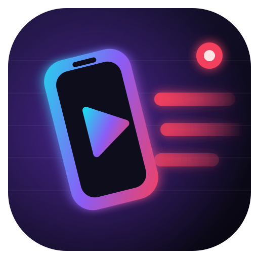
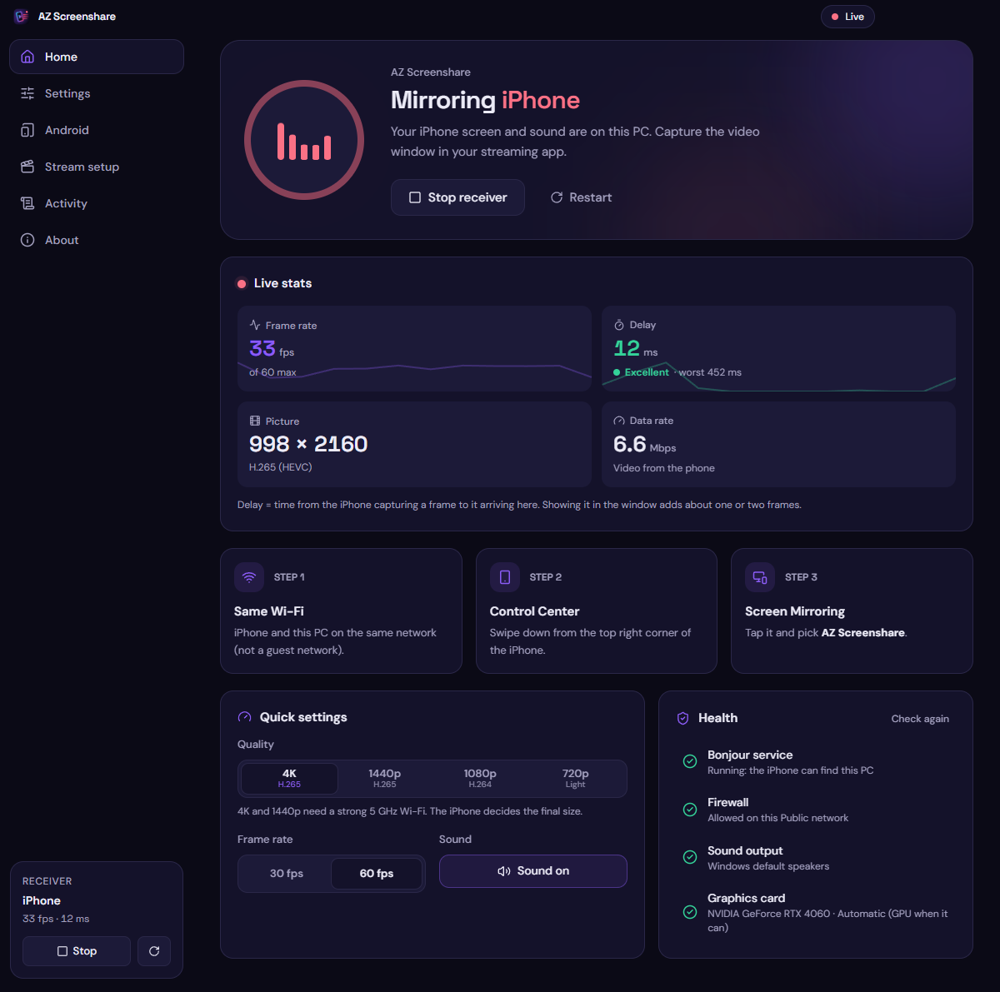
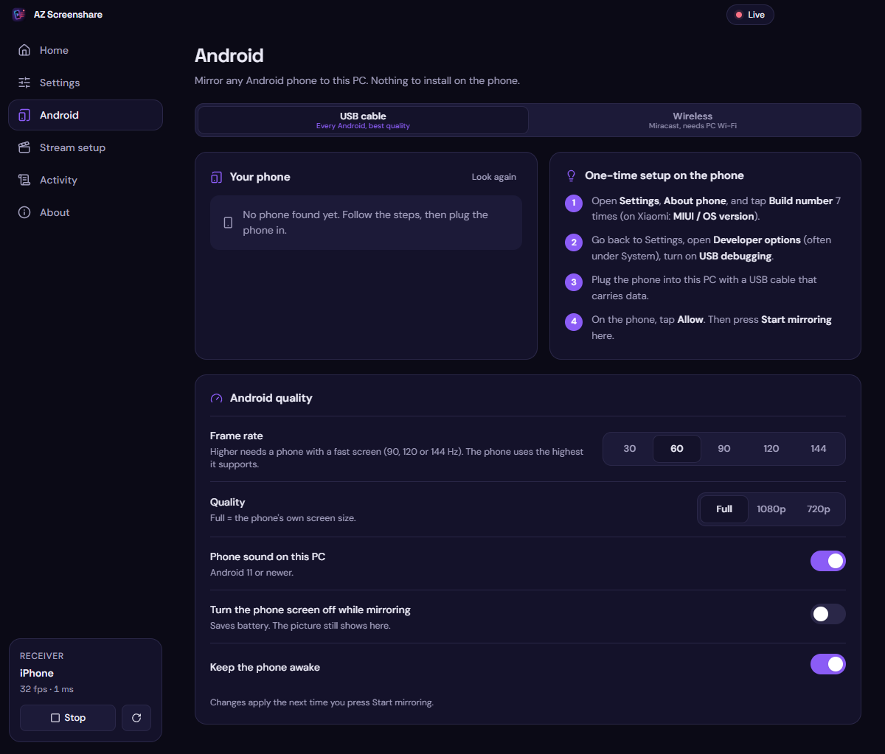
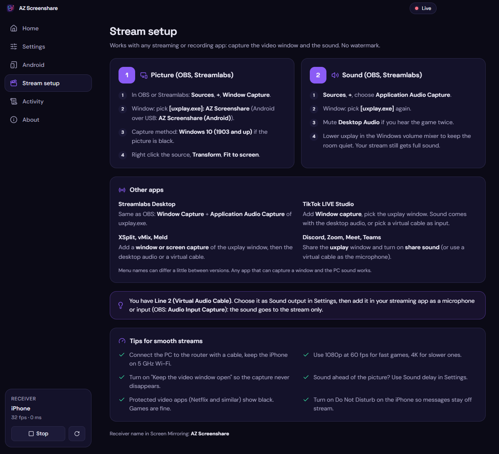
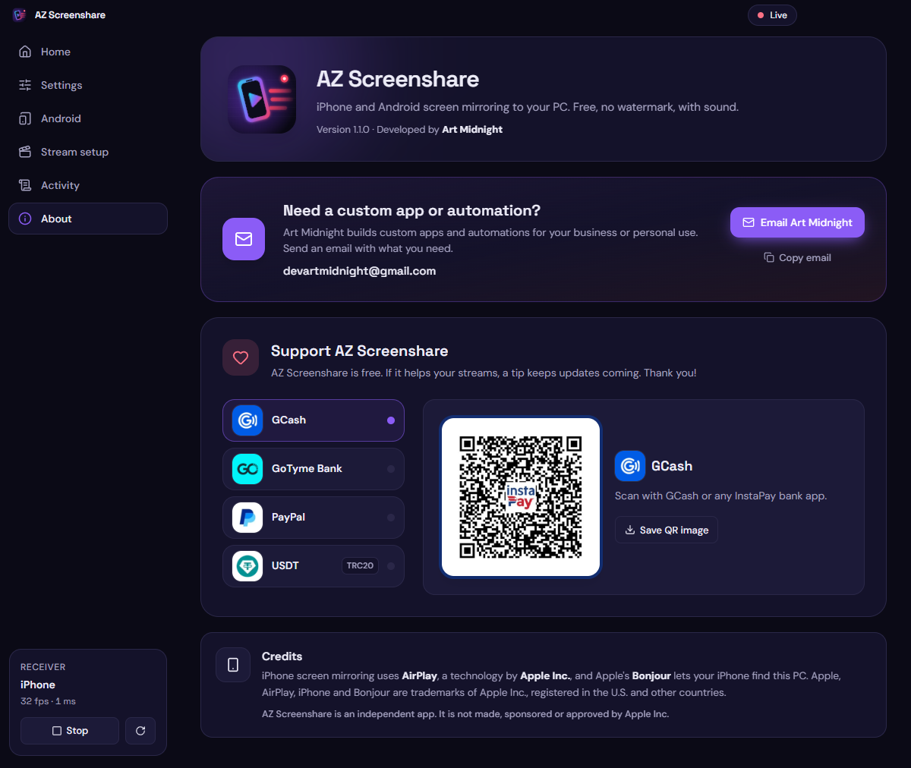
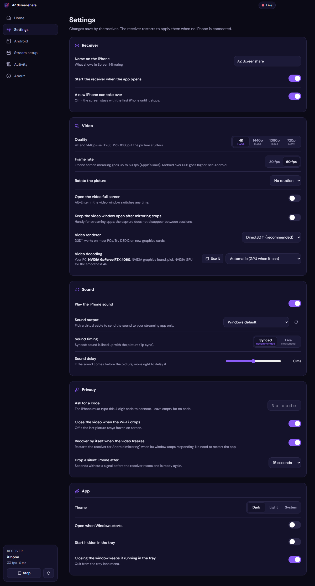
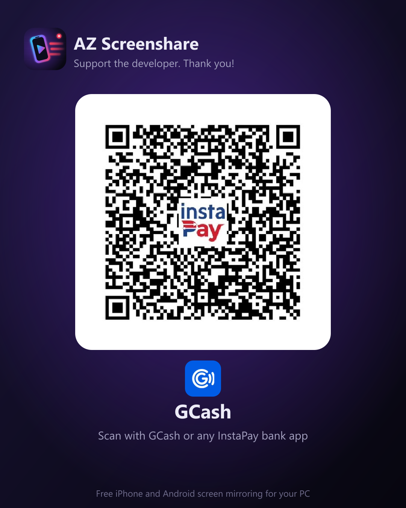
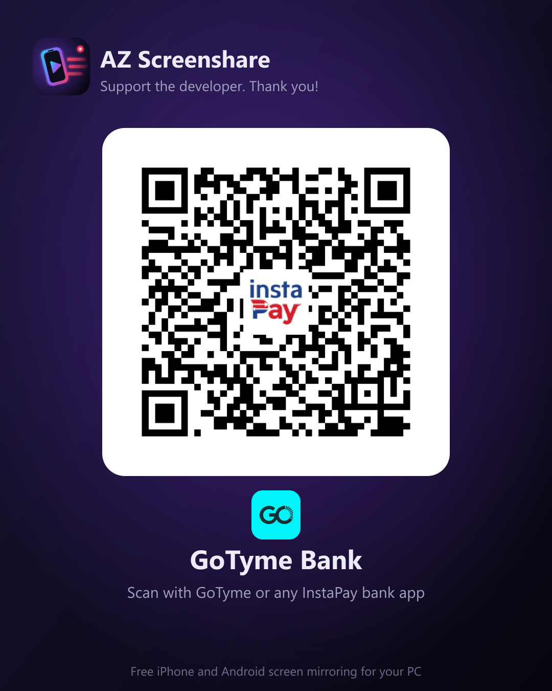
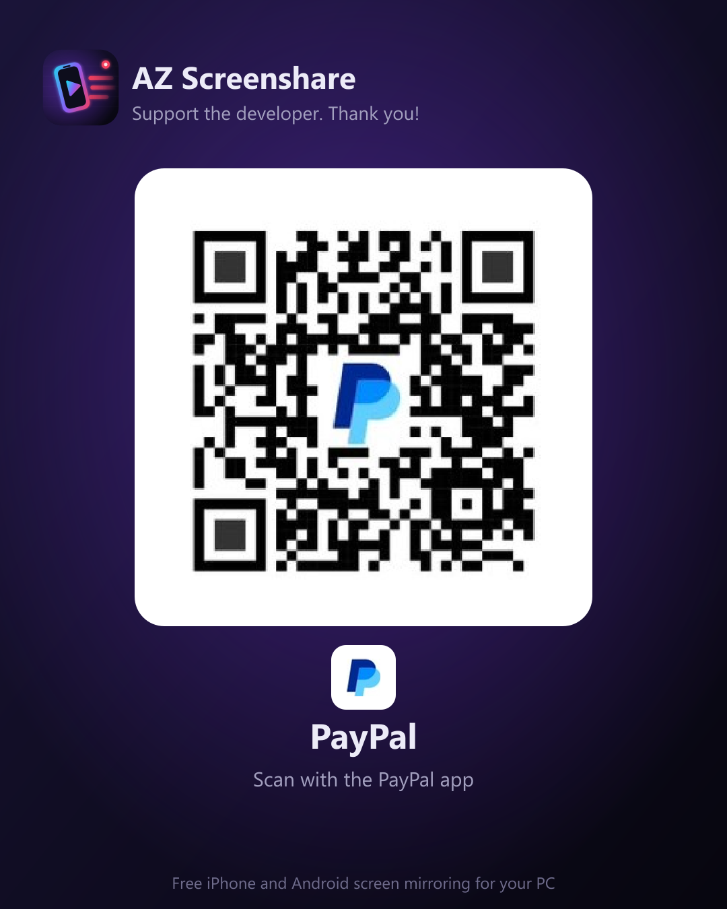
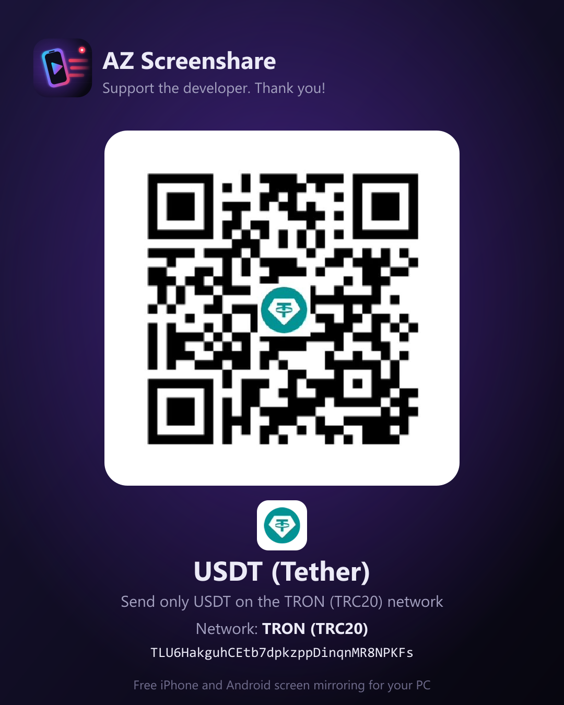

# AZ Screenshare

**Mirror your iPhone or Android phone to your Windows PC, with sound. Free, no watermark, ready for streaming.**

No app on the phone. iPhone connects with the Screen Mirroring button that is already in Control Center.
Android connects with a USB cable (every Android phone) or wirelessly with Miracast.

[**Download for Windows**](../../releases/latest) · [How to use](#how-to-use) · [Streaming apps](#use-it-in-your-streaming-app) · [Troubleshooting](#troubleshooting) · [Support](#support-the-developer)

---

## Why AZ Screenshare

| | AZ Screenshare | Typical "free" mirroring apps |
|---|---|---|
| Watermark | **None** | Often, until you pay |
| Quality | **Up to 4K** on iPhone, **full screen size** on Android | 720p or 1080p unless you pay |
| Frame rate | **60 fps** iPhone, **up to 144 fps** Android over USB | 30 fps |
| Sound | **Yes**, separate so you can stream it | Sometimes, or paid |
| App on the phone | **None** | Usually required |
| Price | **Free** | Subscription |

## Features

**iPhone and iPad (AirPlay)**
- Uses the Screen Mirroring button that every iPhone and iPad already has. Nothing to install on the phone.
- Up to **4K** (H.265) or 1440p, 1080p and 720p, at 30 or 60 fps. The phone decides the final size.
- Sound plays on the PC. Pick any output, including a virtual audio cable that goes straight to your stream.
- Sound delay slider to line the sound up with the picture.
- Optional 4 digit code the iPhone must type before it can connect.
- A new iPhone can take over the screen, or the first one keeps it: your choice.

**Android**
- **USB cable:** works on every Android phone from Android 5, including Google Pixel. Sharpest and smoothest picture, **30 to 144 fps** (the phone runs at the highest its screen supports), sound on Android 11 and newer. Nothing stays installed on the phone.
- **Wireless (Miracast):** through Windows' own receiver, for phones with Smart View, Cast or Screen Cast (Samsung, Xiaomi, OPPO, Vivo, realme, Huawei, Honor, Motorola). Needs Wi-Fi on the PC.
- Options: frame rate, quality, phone sound, turn the phone screen off while mirroring, keep the phone awake.

**For streamers**
- The mirroring window is named **AZ Screenshare** (Android: **AZ Screenshare (Android)**), so it is easy to pick in OBS, Streamlabs, TikTok LIVE Studio, XSplit, vMix, Discord and others.
- Step by step setup for the popular streaming apps inside the app.
- Option to keep the video window open between sessions, so your capture never disappears.

**Smooth and reliable**
- **GPU video decoding:** NVIDIA (NVDEC), Intel (Quick Sync), AMD and others through Direct3D 11 or 12. The app detects your graphics card and suggests the best choice, and falls back to Automatic by itself if a choice does not work.
- **Sound starts instantly** on every new video, reel or song: no silent first seconds.
- The mirroring window opens in your phone's exact shape (portrait or landscape), fitted to your screen, with no black bars. You can still resize it.
- **Recovers by itself:** if the video window freezes, the receiver restarts on its own (no need to restart the app), and a frozen picture closes when the Wi-Fi drops.
- Health check on the Home screen: Bonjour service, Windows Firewall (with a one click **Fix it**), sound output and graphics card.
- **Live stats** while mirroring: frame rate, delay from phone to PC (rated Excellent to High, with the worst value), picture size and codec, and data rate, with small live graphs. Android over USB shows its live frame rate too.
- Activity log you can copy when you need help, also saved to a file.

**Made to feel modern**
- Dark, light or system theme. Runs quietly in the tray. Can start with Windows.

## Screenshots

<table>
  <tr>
    <td> <b>Home:</b> status, steps and health check</td>
    <td> <b>Android:</b> USB cable or wireless</td>
  </tr>
  <tr>
    <td> <b>Stream setup:</b> OBS and other apps</td>
    <td> <b>About:</b> contact and support</td>
  </tr>
  <tr>
    <td colspan="2"> <b>Settings:</b> receiver, video, GPU, sound, privacy and app options</td>
  </tr>
</table>

## Requirements

- **Windows 10 or 11, 64 bit.**
- **iPhone or iPad:** on the **same network** as the PC (Wi-Fi, or the PC on a cable to the same router). Not a guest network.
- **Android over USB:** a USB cable that carries data, and USB debugging turned on once (steps below).
- **Android wireless:** Wi-Fi on the PC (a USB Wi-Fi adapter works) and Windows' free "Wireless Display" feature.
- **Apple Bonjour** (free). The installer offers to install it if it is missing. It lets your iPhone find the PC.

## Install

1. Download **AZ-Screenshare-Setup-1.0.0.exe** (or the newest version) from the [latest release](../../releases/latest).
2. Run it. If Windows shows **"Windows protected your PC"**, click **More info**, then **Run anyway** (the app is not code signed yet).
3. Click **Yes** on the Windows permission prompt. The installer:
   - allows only the AZ Screenshare receiver through Windows Firewall, on every network type (many home networks are marked "Public" in Windows),
   - offers to install Apple Bonjour if it is missing.
4. Open **AZ Screenshare**. The Home screen should say **Ready to mirror** with all checks green.

To uninstall: Windows Settings, Apps, AZ Screenshare, Uninstall. The firewall rule is removed too.

## How to use

### iPhone or iPad
1. Make sure the iPhone and the PC are on the same network.
2. Open **Control Center** (swipe down from the top right corner).
3. Tap **Screen Mirroring** and pick **AZ Screenshare**.
4. The video window opens with your screen and sound. Press **Alt+Enter** in it for full screen.

### Android with a USB cable (recommended)
One-time setup on the phone:
1. **Settings**, **About phone**, tap **Build number** 7 times (on Xiaomi: **MIUI / OS version**).
2. Back in Settings, open **Developer options** (often under System) and turn on **USB debugging**.

Every time:
1. Plug the phone into the PC.
2. On the phone, tap **Allow** on "Allow USB debugging?" (tick "Always allow from this computer").
3. In AZ Screenshare, open **Android**, **USB cable**, and press **Start mirroring**.

Nothing is installed on the phone: a small helper runs only while you mirror and is removed when you stop.

### Android wireless (Miracast)
1. In AZ Screenshare, open **Android**, **Wireless**. If "Windows Wireless Display" is missing, press **Install Wireless Display** and add it once.
2. Press **Open the Android receiver**.
3. On the phone, open Quick Settings and tap **Smart View**, **Cast**, **Screen Cast** or **Wireless projection**, then pick the PC.

Google Pixel phones do not support Miracast: use the USB cable.

## Use it in your streaming app

**OBS Studio and Streamlabs Desktop**
1. **Sources**, **+**, **Window Capture**, Window: **[uxplay.exe]: AZ Screenshare** (Android over USB: **AZ Screenshare (Android)**).
2. If the picture is black, set Capture method to **Windows 10 (1903 and up)**.
3. **Sources**, **+**, **Application Audio Capture**, pick the same window for the sound.
4. Mute **Desktop Audio** if you hear the game twice.

**TikTok LIVE Studio, XSplit, vMix, Meld:** add a window capture of the AZ Screenshare window, plus the desktop audio or a virtual audio cable.

**Discord, Zoom, Google Meet, Teams:** share the AZ Screenshare window and turn on "share sound".

**Tip:** pick a virtual audio cable (for example VB-Audio Virtual Cable) as **Sound output** in Settings, then add it as an audio input in your streaming app. The game sound goes to your stream only, not your speakers.

## Settings explained

| Setting | What it does |
|---|---|
| Name on the iPhone | The name shown in Screen Mirroring. |
| Quality | 4K and 1440p use H.265 and need strong 5 GHz Wi-Fi. 1080p is the safe choice for fast games on weaker Wi-Fi. |
| Frame rate | 30 or 60 fps for iPhone (60 is Apple's limit for screen mirroring, also on 120 Hz iPhones). Android over USB: 30 to 144 fps. |
| Video decoding (GPU) | Automatic, NVIDIA, Intel, any GPU through Direct3D 11 or 12, or processor only. Uses your graphics card so games stream smoother. |
| Video renderer | Direct3D 11 works on most PCs, Direct3D 12 on newer graphics cards. |
| Sound output and delay | Where the phone's sound plays, and how much to delay it to match the picture. |
| Ask for a code | The iPhone must type a 4 digit code to connect. |
| Close the video when the Wi-Fi drops | Closes the window instead of leaving a frozen picture. |
| Keep the video window open | Keeps the capture alive between sessions in your streaming app. |
| App | Theme, start with Windows, start in the tray, keep running in the tray when closed. |

## Troubleshooting

**The iPhone does not see "AZ Screenshare"**
- iPhone and PC on the same network, not a guest network, no VPN on the phone.
- Home screen, Health: Bonjour service must be green. If not, press **Install**.
- Firewall must be green. If not, press **Fix it** and click Yes.
- Restart the receiver with the round arrow button.

**The iPhone connects but there is no picture**
- Look for the **AZ Screenshare** window on the taskbar.
- Settings, Video decoding: try **Processor only**, or Video renderer **Direct3D 12**.

**The picture stutters**
- Look at **Live stats** on the Home screen: a high or jumping delay means the Wi-Fi is the problem.
- Use 1080p, connect the PC to the router with a cable, keep the iPhone on 5 GHz Wi-Fi and close to the router.

**The sound is ahead of or behind the picture**
- Settings, Sound delay.

**Android: "No phone found"**
- USB debugging on, a data cable (some cables only charge), tap **Allow** on the phone, then **Look again**.
- Try another USB port, and set the phone's USB mode to "File transfer".

**Netflix, Disney+ and similar apps show black**
- These apps block screen mirroring on purpose. Games and most other apps are fine.

When asking for help, open **Activity**, press **Copy** and paste it in your message.

## FAQ

**Is it really free?** Yes. No watermark, no time limit, no paid tier.

**Do I need to install something on my phone?** No. iPhone uses its built-in Screen Mirroring. Android over USB runs a temporary helper that is removed when you stop.

**Can it do 8K or 120 fps on iPhone?** No receiver can: AirPlay screen mirroring from an iPhone tops out at 4K and 60 fps. Android over USB goes up to 144 fps if the phone's screen supports it.

**Does it work on Mac or Linux?** It is made for Windows 10 and 11.

**Does the phone need internet?** No, only the same local network (iPhone) or the USB cable (Android).

## Need a custom app or automation?

AZ Screenshare is made by **Art Midnight**. I build custom apps and automations for your business or personal use.

Email: **[devartmidnight@gmail.com](mailto:devartmidnight@gmail.com?subject=Custom%20app%20or%20automation)**

## Support the developer

AZ Screenshare is free. If it helps your streams, a tip keeps updates coming. Thank you!
The same QR codes are in the app under **About**, with a **Save QR image** button.

<table>
  <tr>
    <td align="center"> <b>GCash</b></td>
    <td align="center"> <b>GoTyme Bank</b></td>
    <td align="center"> <b>PayPal</b></td>
    <td align="center"> <b>USDT (TRON, TRC20)</b></td>
  </tr>
</table>

USDT address (TRON network, TRC20 only): `TLU6HakguhCEtb7dpkzppDinqnMR8NPKFs`
Send only USDT on the TRON (TRC20) network. Other coins or networks will be lost.

Only download AZ Screenshare and its support QR codes from this page.

## Credits and licenses

AZ Screenshare is built on these free and open source projects, included in the installer under their own licenses:

- **[UxPlay](https://github.com/FDH2/UxPlay)** (GPL-3.0): the AirPlay receiver.
- **[GStreamer](https://gstreamer.freedesktop.org)** (LGPL-2.1): video and sound playback.
- **[scrcpy](https://github.com/Genymobile/scrcpy)** (Apache-2.0): Android mirroring over USB, with Android's adb tool.
- **Apple Bonjour:** lets the iPhone find the PC (installed separately from Apple).

Details, the source changes and how to rebuild them: [THIRD-PARTY-NOTICES.md](THIRD-PARTY-NOTICES.md).

iPhone screen mirroring uses AirPlay, a technology by Apple Inc. Apple, AirPlay, iPhone, iPad and Bonjour are trademarks of Apple Inc., registered in the U.S. and other countries. Android is a trademark of Google LLC. GCash, GoTyme, PayPal and Tether (USDT) are trademarks of their owners. **AZ Screenshare is an independent app. It is not made, sponsored or approved by Apple Inc. or Google LLC.**

## License

**AZ Screenshare is free to use, but it is not open source.** The app's own source code is not published.

- **You may:** download, install and use it for free, also for streams and videos that earn money, and share the official unchanged installer for free with a link to this page.
- **You may not:** sell it or charge for it, change, unpack or reverse engineer it, reuse its code, design, name or logo, publish changed or rebranded copies, or present it as your own work.

Full text: [LICENSE.txt](LICENSE.txt) (also shown in the installer). The open source programs inside it keep their own licenses, see [THIRD-PARTY-NOTICES.md](THIRD-PARTY-NOTICES.md).

The AZ Screenshare app (its code, interface, design, name and logo) is © 2026 Art Midnight. All rights reserved.
